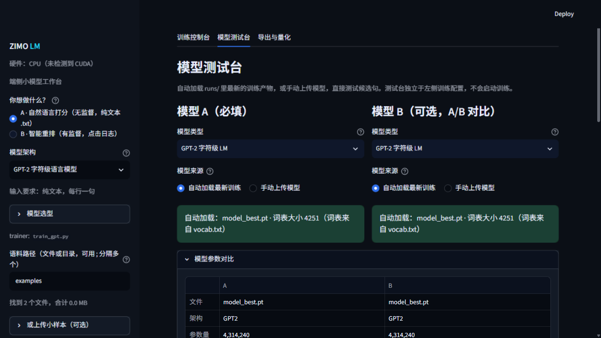
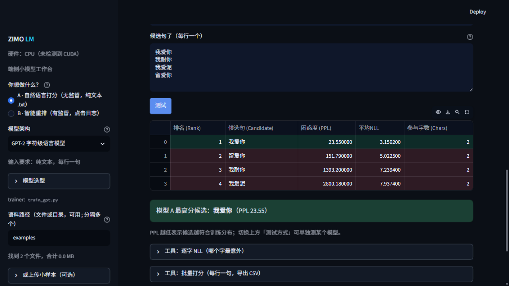

<h1 align="center">zimo-lm</h1>

<p align="center">
  <b>Turn a Chinese corpus into a few-MB reranking model that runs on the edge.</b><br/>
  Train → evaluate → quantize → export to a C++ engine, all from one local page.
</p>

<p align="center">
  <a href="https://github.com/Wotrix/zimo-lm/actions/workflows/ci.yml"></a>
  
  
  
  
  
  
</p>

<p align="center">
  <a href="README.md">中文</a> · <b>English</b>
</p>

<p align="center">
  
</p>

---

## What it is

**Zimo Studio** is a local workbench for edge-scale language models, built
around Chinese text:

- Train **1M–44M parameter** character-level LMs that score how natural a
  sentence is
- With click logs, train **candidate rerankers** (listwise)
- One pipeline: corpus cleaning → training → live monitoring → playground →
  INT8 quantization → export
- Everything runs locally on CPU/GPU; no data leaves the machine

It is **not** a general LLM trainer, and it does **not** do pinyin decoding:
keystrokes → characters belongs to the IME engine; this only scores and
reranks candidates afterwards.

## Features

| Area | What you get |
|---|---|
| Training console | Free-form architecture and training params, four presets, corpus cleaning, **detached training** (survives browser close / SSH drop), resume from checkpoint, loss/PPL/throughput charts |
| Model playground | Auto-load or upload, A/B spec comparison, candidate scoring (rank 1 green, outliers red), per-character NLL, batch scoring to CSV, sampled generation, **correction hints**, proper-noun protection |
| Export & quantization | ONNX (FP32/INT8), TorchScript, TFLite (experimental), safetensors, **TJGPT** (engine-native), custom bundle name, generated C++ skeleton |
| Multi-format loading | `.pt` / `.pth` / `.ckpt` / `.bin` / `.safetensors`; missing config is inferred from tensor shapes |

## Quickstart

```bash
git clone https://github.com/Wotrix/zimo-lm.git
cd zimo-lm

./setup.sh    # macOS/Linux. Windows: setup.bat
./run.sh      # macOS/Linux. Windows: run.bat   -> http://127.0.0.1:8769
```

**No training needed to try it**: the repo ships a 4.31M-parameter demo model
(`examples/demo/`). Open the playground, type a few candidates, and you get
scores, per-character NLL and correction hints immediately.

See [quickstart.md](quickstart.md) for details.

## Screenshots

<p align="center">
  
</p>

<p align="center">
  <sub>Sorted by PPL: rank 1 in green, outliers in red. Below: per-character NLL, batch scoring, generation and correction tools.</sub>
</p>

## What you can train

| Data you have | What you get | Typical use |
|---|---|---|
| Plain text from any domain | Domain character scorer (GPT-2 / LSTM) | Text grading, corpus cleaning, in-domain completion |
| User click logs | Cross-encoder (TJTR1) / feature ranker (TJMLP1) | n-best reranking for IME, search, ASR, MT |
| Tokenized corpus + vocab | Statistical n-gram (3-gram / word-level) | MCUs and very low-resource devices |

Character-level tokenization means **no tokenizer needed** — Chinese corpora
work as-is. The trade-off: a few-thousand-token vocabulary and weak
cross-lingual ability.

## Deployment formats

| Format | Purpose | Runtime dependency |
|---|---|---|
| `.safetensors` | Archive / exchange | PyTorch or a tensor reader |
| `.onnx` (FP32/INT8) | Cross-framework inference | onnxruntime |
| **`.tjgpt`** | **Read directly by a C++ engine** | **none** (ships `TjgptModel`, aligned with PyTorch) |
| `.zip` | All artifacts + `vocab.txt` + README | — |

INT8 is roughly 1/4 the size of FP32 with PPL drift usually under 0.2%.

## Docs

- [quickstart.md](quickstart.md) — install, run, train your first model
- In-app "使用说明 / Docs" — a twelve-chapter manual: model types, the six
  trainers, five customization dimensions, deployment matrix, metrics, FAQ
- [MODEL_CARD.md](MODEL_CARD.md) · [DATA_CARD.md](DATA_CARD.md)

## Boundaries

- No candidate generation, no pinyin handling — scoring and reranking only
- 4–44M parameters: domain-level ability, not a general assistant
- The trainer is deliberately simple (no AMP/DDP/BPE) for readability and
  reproducibility

## License

MIT. Corpora you train on (LCCC and others) keep their own licenses; none are
bundled here.

---

<p align="center">
  <sub>If this saved you a few days, a ⭐ or an issue about what you built is welcome.</sub>
</p>
