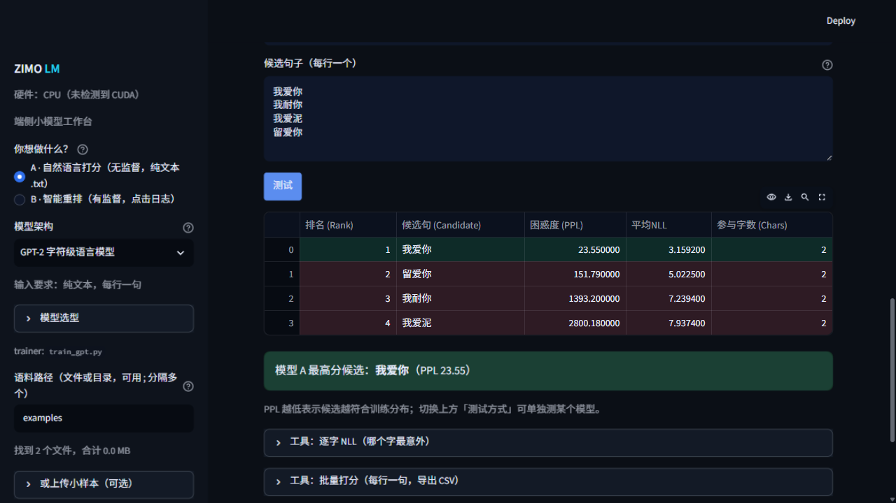
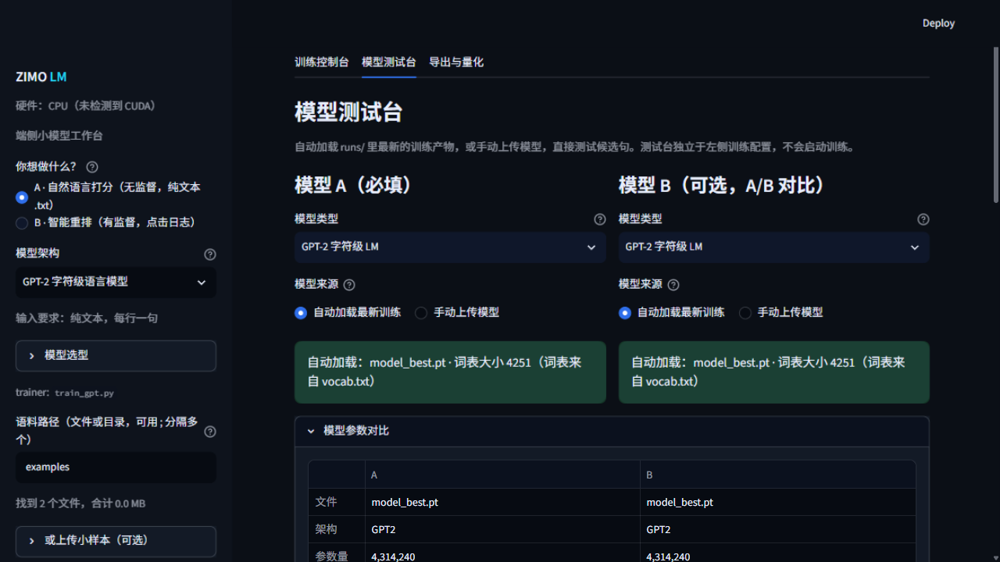
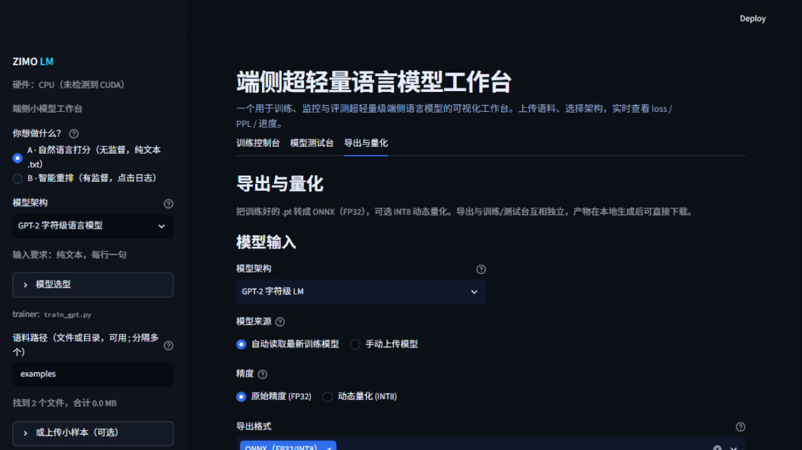

<h1 align="center">zimo-lm · 字模</h1>

<p align="center">
  <b>把一段中文语料，变成几 MB、能在端侧跑的候选重排模型。</b><br/>
  训练 → 评测 → 量化 → 导出到 C++ 引擎，全在一个本地页面里完成。
</p>

<p align="center">
  <a href="https://github.com/Wotrix/zimo-lm/actions/workflows/ci.yml"></a>
  
  
  
  
  
  
</p>

<p align="center">
  <b>中文</b> · <a href="README.en.md">English</a>
</p>

<p align="center">
  
</p>

---

## 这是什么

**Zimo Studio** 是一个本地运行的端侧小模型工作台，面向中文场景：

- 训练 **1M–44M 参数**的字符级语言模型，给文本打「自然不自然」的分
- 有用户点击日志时，训练**候选重排模型**（listwise）
- 一条链路走完：语料清洗 → 训练 → 实时监控 → 测试台 → INT8 量化 → 导出
- 全程本机 CPU/GPU，数据不出机器

它**不是**通用大模型训练器，也**不做拼音解码**——按键转汉字由输入法引擎负责，这里只负责候选生成之后的打分与重排。

## 功能

| 模块 | 能力 |
|---|---|
| 训练控制台 | 结构参数自由填写、四种预设、语料清洗、**后台守护训练**（断 SSH 不停）、断点续训、**bf16 混合精度（与 FP32 误差 ~3e-5）**、loss/PPL/吞吐曲线；命令行用 `python monitor.py -w` 看同款进度面板 |
| 模型测试台 | 自动加载或上传模型、A/B 参数对比、候选打分（Rank1 绿 / 离谱红）、逐字 NLL、批量打分导出 CSV、文本生成、**纠错建议**、专有名词保护 |
| 导出与量化 | ONNX（FP32/INT8）、TorchScript、TFLite（实验）、safetensors、**TJGPT**（引擎直读）、自定义包名、C++ 推理骨架 |
| 多格式加载 | `.pt` / `.pth` / `.ckpt` / `.bin` / `.safetensors`，缺配置时按权重形状反推 |

## 快速开始

```bash
git clone https://github.com/Wotrix/zimo-lm.git
cd zimo-lm

./setup.sh    # Windows: setup.bat   （创建 .venv 并安装依赖）
./run.sh      # Windows: run.bat     （启动 http://127.0.0.1:8769）
```

想把启动做成全局命令：把 `zimo.bat`（或软链 `zimo.sh`）放进 PATH，之后任意目录
`zimo` 即可，`zimo --port 8800` 可换端口。

**不用训练也能玩**：仓库自带 4.31M 参数的示例模型（`examples/demo/`），
打开「模型测试台」输入几行候选即可看到打分、逐字 NLL 与纠错建议。

安装脚本会**自动识卡**：有 NVIDIA 显卡就装 CUDA 版 PyTorch，没有就装 CPU 版
（`setup.bat --check` 可先看清会装什么）。卸载用 `uninstall.bat` / `uninstall.sh`，
它只删 `.venv`，不碰系统环境。

更多细节见 [quickstart.md](quickstart.md)。

## 截图

<table>
  <tr>
    <td width="50%"></td>
    <td width="50%"></td>
  </tr>
  <tr>
    <td align="center"><sub>模型测试台：结构参数并排对比、候选打分、逐字 NLL 与纠错工具</sub></td>
    <td align="center"><sub>导出与量化：ONNX FP32/INT8、safetensors、TJGPT、C++ 推理骨架</sub></td>
  </tr>
</table>

## 能训什么

| 你手里的数据 | 训练产物 | 典型用途 |
|---|---|---|
| 任意领域纯文本 | 领域字符级打分器（GPT-2 / LSTM） | 文本质量分级、语料清洗、域内补全 |
| 用户点击日志 | 交叉重排器（TJTR1）/ 特征重排器（TJMLP1） | 输入法、搜索、ASR、MT 的 n-best 重排 |
| 分词语料 + 词表 | 统计 n-gram（3-gram / 词级） | MCU 与极低资源设备 |

字符级切分意味着**不需要分词器**，中文语料开箱即用；代价是词表只有几千、跨语言能力弱。

语料可以是单个文件、整个目录，或多选上传；支持 `.txt` / `.jsonl` / `.jsonl.gz`，
UTF-8（含 BOM）与 GBK/GB18030 都能正确解码。

## 部署格式

| 格式 | 用途 | 运行时依赖 |
|---|---|---|
| `.safetensors` | 归档 / 交换 | PyTorch 或自写张量读取 |
| `.onnx`（FP32/INT8） | 跨框架推理 | onnxruntime |
| **`.tjgpt`** | **C++ 引擎直读** | **无**（配套 `TjgptModel`，已与 PyTorch 逐条对齐） |
| `.zip` | 打包全部产物 + `vocab.txt` + README | — |

INT8 体积约为 FP32 的 1/4，PPL 偏差通常 < 0.2%。

## 在线演示（可选）

仓库里有云端演示入口 `app_cloud.py`：只开测试台与导出，用自带示例模型，
**不含训练**（云端既没有语料也不适合长计算）。

想在自己账号上部署，见 [docs/deploy-cloud.md](docs/deploy-cloud.md)
（Streamlit Community Cloud / Hugging Face Spaces 两种方式与踩坑表）。

## 文档

- [quickstart.md](quickstart.md) — 安装、跑通、训第一个模型
- [docs/cli.zh.md](docs/cli.zh.md) — 命令行训练完整指引（参数表、配方、常见错误、进度面板）
- [docs/rent-gpu.md](docs/rent-gpu.md) — 租 GPU 训练全流程（选卡、装环境、冒烟、配方、费用）
- Studio 内「使用说明 / Docs」— 十二章规格书：模型类型、六个训练器规格、五维自定义、部署平台、指标与常见问题
- [MODEL_CARD.md](MODEL_CARD.md) · [DATA_CARD.md](DATA_CARD.md) — 模型与数据说明

## 边界

- 不生成候选，只打分/重排；不处理拼音
- 4–44M 参数，对话/领域级能力，不是通用助手
- 训练器刻意保持简单（无 AMP/DDP/BPE），追求可读与可复现

## 许可

MIT。训练用的语料（LCCC 等）请遵守其各自许可，本仓库不附带语料。

---

<p align="center">
  <sub>如果这个工具帮你省了几天时间，欢迎点个 ⭐ 或提 issue 告诉我你用它做了什么。</sub>
</p>
